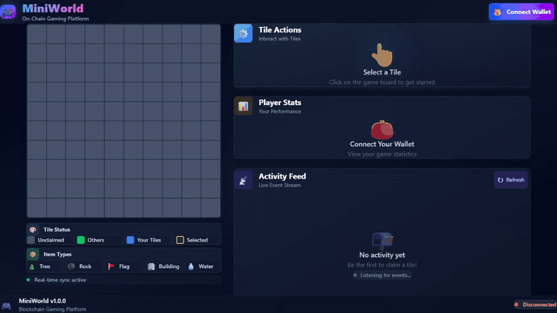

# MiniWorld

[](https://github.com/Exalt24/Miniworld/actions/workflows/ci.yml)



*Recorded against the local Docker stack with a scripted stand-in for a browser wallet (details in [docs/DEMO_RECORDING.md](docs/DEMO_RECORDING.md)). Everything in it runs on the local stack.*

Multiplayer Web3 game on a local Ethereum chain: a Solidity 10x10 tile world, an event indexer and two React apps. Players claim tiles on a 10x10 grid and place items on them, with all game state in a Solidity contract. A backend indexes the contract events into PostgreSQL, serves a REST API and pushes updates over WebSocket, and a TypeScript SDK wraps the contract and API for two React apps: a player client and a creator analytics dashboard. The whole stack runs locally in Docker.

## Contents

- [Overview](#overview)
- [Documentation](#documentation)
- [Architecture](#architecture)
- [Quick start](#quick-start)
- [Project structure](#project-structure)
- [Development and API reference](#development-and-api-reference)
- [Testing](#testing)
- [Multi-tenant API layer](#multi-tenant-api-layer)
- [Tech stack](#tech-stack)

## Overview

- Game state lives in the `MiniWorld.sol` contract: tile ownership and item placement
- A WebSocket feed (Socket.IO) pushes tile and item events to every connected client
- The player client is a React 19 app that draws the board on a canvas
- The creator dashboard shows activity and statistics with Recharts
- The SDK exposes contract calls, REST reads and WebSocket events, and has the contract ABI bundled at build time
- Docker Compose runs everything with one script

## Documentation

- [API reference](docs/API.md): REST endpoints and WebSocket events
- [Architecture](docs/ARCHITECTURE.md): system design, data flow and how the ABI gets distributed
- [Deployment](docs/DEPLOYMENT.md): container orchestration and notes on deploying beyond a local machine
- [Demo recording](docs/DEMO_RECORDING.md): how the GIF at the top was recorded
- [Multi-tenant API](docs/SAAS_API.md): Express routes and Sequelize models with migrations on PostgreSQL, tenants, plans, subscriptions, the Redis cache, the MongoDB audit log and the Firebase token check
- [SDK guide](sdk/README.md): installation, usage and the SDK API

## Architecture

```
┌─────────────────────────────────────────────────────────┐
│                     Browser layer                        │
├─────────────────────────────────────────────────────────┤
│  Game client (3000)  │  Creator dashboard (3001)        │
│  • Canvas game board │  • Analytics charts              │
│  • Real-time updates │  • Event log                     │
│  • SDK integration   │  • Player management             │
└────────────┬────────────────────────┬───────────────────┘
             │                        │
             │   MiniWorld SDK (bundled into frontends)
             │   • Contract ABI baked in at build time
             │   • WebSocket client
             │   • Transaction handling
             │                        │
┌────────────┴────────────────────────┴───────────────────┐
│                   Backend layer                          │
├─────────────────────────────────────────────────────────┤
│  Backend API (4000)                                     │
│  • REST API (8 endpoints)                               │
│  • WebSocket server (Socket.IO)                         │
│  • Event indexer                                        │
│  • Contract ABI loaded from build                       │
└────────────┬──────────────────┬─────────────────────────┘
             │                  │
    ┌────────┴────────┐  ┌─────┴──────────┐
    │  PostgreSQL 18   │  │  Hardhat node  │
    │  • World state   │  │  • Smart       │
    │  • Event log     │  │    contracts   │
    │  • Stats cache   │  │  • Local EVM   │
    └──────────────────┘  └────────────────┘
```

### How the contract ABI reaches each component

1. Deploying the contracts generates `contracts/artifacts/MiniWorld.json`.
2. The backend build copies the ABI into its Docker image.
3. The SDK build runs a prebuild script that copies the ABI into `sdk/src/contractABI.ts`, and TypeScript compiles the SDK with it.
4. The frontend builds import the SDK, and Vite bundles the ABI into the JavaScript.

Every component has the ABI without fetching it at runtime.

## Quick start

You need Docker Desktop (Windows or Mac) or Docker Engine (Linux), and PowerShell to run the deploy script (it is a `.ps1`; there is no Bash version). Node.js 22.12 or newer is only needed for local development outside Docker.

```powershell
git clone https://github.com/Exalt24/Miniworld.git
cd Miniworld
.\scripts\docker-deploy-all.ps1
```

The script publishes ports 3000, 3001, 4000, 5432 and 8545 on the host, so those must be free. Reading the board and the dashboard needs no wallet. Claiming a tile or placing an item sends a transaction, so those need a browser wallet (MetaMask) on the local Hardhat network, as described in [MetaMask will not connect](docs/DEVELOPMENT.md#metamask-will-not-connect).

The script cleans the previous deployment, starts PostgreSQL and the Hardhat node, deploys the contracts, generates and distributes the ABI, builds the backend, SDK and frontends, starts the containers and checks that they are healthy. The first run takes several minutes and later runs are faster.

| Application | URL | Purpose |
|-------------|-----|---------|
| Game client | http://localhost:3000 | Play the game |
| Creator dashboard | http://localhost:3001 | View analytics |
| Backend API | http://localhost:4000/api | API endpoints |
| Health check | http://localhost:4000/api/health | Service status |

## Project structure

```
miniworld/
├── contracts/              # Smart contracts (Solidity + Hardhat 3)
│   ├── contracts/
│   │   └── MiniWorld.sol   # Main game contract
│   ├── ignition/           # Hardhat Ignition deployment
│   ├── test/               # Contract tests (37)
│   └── artifacts/          # Generated ABI (not in git)
│
├── backend/                # Event indexer + REST API
│   ├── src/
│   │   ├── config/         # Database and blockchain config
│   │   ├── services/       # Event processing and game logic
│   │   ├── api/            # Express routes (8 endpoints)
│   │   ├── types/          # Shared TypeScript types for the services
│   │   └── websocket/      # Socket.IO server
│   └── migrations/         # SQL schema migrations
│
├── sdk/                    # TypeScript SDK for the contract and API
│   ├── src/
│   │   ├── MiniWorldSDK.ts # Main SDK class
│   │   ├── types.ts        # Type definitions
│   │   ├── contractABI.ts  # Generated ABI (empty template in git)
│   │   └── index.ts        # Public exports
│   ├── scripts/
│   │   └── copy-abi.js     # Prebuild script (copies ABI)
│   └── test/               # SDK test script and a browser test page
│
├── game-client/            # Player-facing React app
├── creator-dashboard/      # Analytics dashboard
├── docker/                 # Dockerfiles and nginx configs
├── scripts/                # docker-deploy-all.ps1, docker-status.ps1
│   └── demo/               # wallet-stub.js and record-demo.cjs (how docs/demo.gif was recorded)
├── docs/                   # API, architecture and deployment notes, plus demo.gif
├── docker-compose.yml      # Base service configuration (dev overrides baked in)
└── docker-compose.prod.yml # Production-style configuration (see docs/DEPLOYMENT.md)
```

## Development and API reference

The workflow for contract, backend, SDK and frontend changes, the day to day Docker commands and the troubleshooting notes are in [docs/DEVELOPMENT.md](docs/DEVELOPMENT.md). The REST endpoints (world, tile, player, activity, stats, sync status, health) and the WebSocket events are in [docs/API.md](docs/API.md).

## Testing

### Contract tests

```powershell
cd contracts
npm install
npm test

# With gas reporting
npm test -- --gas-report

# One test
npm test -- --grep "Should allow claiming"
```

On 2026-10-07 this printed `37 passing`. On 2026-10-11 `docker exec miniworld-contracts npx hardhat test` printed `37 passing` again.

### SDK tests

```powershell
cd sdk
npm install
npm run build
node test/test-node.mjs
```

The script has 79 assert calls. It needs the contract artifacts (the build copies the ABI from `contracts/artifacts`) and, for its API checks, the backend running on port 4000. On 2026-10-07 without the backend it reported 34 passed and 8 failed, and the 8 failures were the API read checks that could not reach port 4000. On 2026-10-11 with the backend running (pointed at the stack's remapped port for that run) it reported 79 passed and 0 failed. Several of the passing lines are status messages rather than assertions. The write and WebSocket checks need a browser and a wallet: serve the folder with `npx http-server -p 8080` and open `http://localhost:8080/test/test-browser.html`.

### Full-stack check

`.\scripts\docker-deploy-all.ps1` ends with a validation step that reports PostgreSQL, the backend API, the 100-tile world state and both frontends.

## Multi-tenant API layer

The backend also carries an account layer for studios that run worlds: tenants with members, a plan and a subscription, mounted at `/api/saas` when `SAAS_ENABLED=true`. It is Express and TypeScript with PostgreSQL through the Sequelize ORM (models plus `sequelize-cli` migrations), a Redis read-through cache for plan lookups that is cleared when a plan changes, an append-only MongoDB audit log with one event per state change, and a middleware that verifies Firebase Auth ID tokens (RS256 signature against Google's published keys, issuer, audience, expiry). Every query on a tenant table is scoped by tenant id. Details are in [docs/SAAS_API.md](docs/SAAS_API.md).

**Built and tested against:** local Postgres 18, Redis 7 and MongoDB 7 containers started from `docker-compose.saas.yml`, and a stand-in Firebase key server (`backend/tests/saas/support/keyserver.ts`) that serves a key set it generated itself and signs the test tokens. The suite covers both directions: a valid token, member and owner are accepted; a wrong tenant, an expired token, a wrong audience, a wrong issuer, a tampered signature, an unknown key id and a plan limit are refused; a plan change empties the cache entry; every change writes one audit event. The first full run on 2026-10-30 passed 51 of 51 tests, and a mutation script that deletes each of 51 guards one at a time saw a test fail every time ([test run](docs/test-runs/saas-tests-2026-10-30.txt), [mutation run](docs/test-runs/saas-mutation-2026-10-30.txt)). CI runs the test suites with the three databases as service containers, and the mutation check runs from a manual dispatch of the same workflow.

```bash
docker compose -f docker-compose.saas.yml up -d --wait
cd backend && npm ci
npm test                 # 51 tests across token checks, tenant isolation, plan cache, audit log and migrations
npm run test:mutation    # delete each guard in turn; a test must fail
docker compose -f docker-compose.saas.yml down -v
```

## Tech stack

### Contracts and blockchain
- Solidity 0.8.30
- Hardhat 3.0.7
- ethers.js 6.13.7
- Local Hardhat node, chain ID 31337

### Backend
- Node.js 22, TypeScript 5.9
- Express 5.1
- PostgreSQL 18 with the `pg` driver 8.13.1
- Socket.IO 4.8.1
- tsx 4.19.2

### Frontend
- React 19.2 and TypeScript 5.9
- Vite 7.1
- Tailwind CSS 4.1
- Recharts 3.2.1 (creator dashboard)
- Nginx (Alpine) to serve the production build

### Tooling
- Docker 24+ and Docker Compose v2

## Security

This is a development setup with default credentials, no API authentication and `CORS_ORIGIN=*`. Before putting anything like it on a public network you would need to change the PostgreSQL password, add authentication and rate limiting to the API, serve it over HTTPS with a real CORS origin, put the contract through a professional audit and test it on a testnet first, and move secrets into a secrets manager.

## Environment variables

Docker Compose sets all of these for the containers, so the Docker route needs no `.env` file. The `.env.example` files in `backend/`, `game-client/` and `creator-dashboard/` hold the values for running a service on the host instead (they point at `localhost` rather than the container names), and the `.env` copies are git-ignored.

### Backend (as set in `docker-compose.yml`)

```env
PORT=4000
DB_HOST=postgres
DB_PORT=5432
DB_NAME=miniworld
DB_USER=postgres
DB_PASSWORD=postgres
RPC_URL=http://contracts:8545
CONTRACT_ADDRESS=0x...  # updated by the deploy script
CHAIN_ID=31337
START_BLOCK=0
GRID_SIZE=10
CORS_ORIGIN=*
```

### Frontend (game client and creator dashboard)

```env
VITE_API_URL=http://localhost:4000/api
VITE_WS_URL=http://localhost:4000
VITE_CONTRACT_ADDRESS=0x...  # the deploy script exports it from the contract it just deployed
```

The compose file passes these to the Vite dev server when the container starts, so after changing one, restart the container. In a production build Vite bakes them into the JavaScript, so the frontend has to be rebuilt.

## Next steps

- A public deployment on a testnet or mainnet
- Latency measurements for the WebSocket feed and the API
- API authentication and rate limiting
- A contract audit
- The demo recording uses a scripted stand-in for the MetaMask wallet

## License

MIT. See the LICENSE file.
